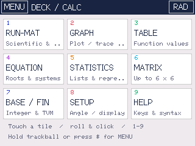
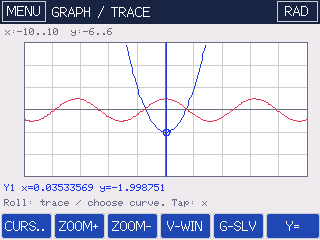
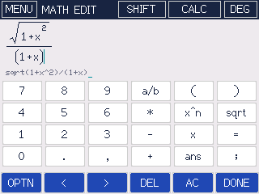
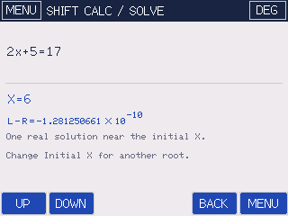
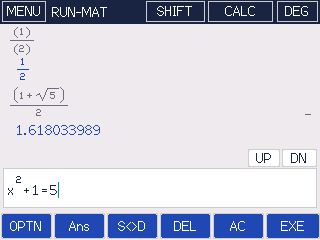

# Deck Calc

A standalone graphing calculator for the **LILYGO T-Deck / T-Deck Plus**: ESP32-S3, 320×240 ST7789, **GT911 capacitive touchscreen**, I²C keyboard, and trackball. The app menu, editable function list, EXE key, view window, and six context-sensitive soft keys are inspired by the Casio fx-CG50. This is independent firmware, not a Casio emulator.

Desktop renders of the application code (not photographs of tested hardware):

  

## Build and flash

Open this folder in PlatformIO, select `t-deck`, and use **Build**, then **Upload**. Or:

```sh
pio run -e t-deck
pio run -e t-deck -t upload
pio device monitor -b 115200
```

The project pins Espressif32 6.3.0 (Arduino ESP32 2.0.9) and includes TFT_eSPI 2.5.43 in `lib/`, including its license. No additional display or touch library download is needed. PlatformIO still needs the platform and compiler packages on a fresh machine. The custom board configuration enables 16MB flash and 8MB OPI PSRAM. Wi-Fi, Bluetooth, audio and LoRa are unused.

If upload cannot connect: hold the trackball center, press/release reset, then upload. Release the center and reset after flashing. Uploading replaces the main ESP32-S3 firmware; the keyboard's separate ESP32-C3 firmware does not need flashing.

The application binary is `.pio/build/t-deck/firmware.bin`. Use PlatformIO Upload to install the bootloader and partition table at the correct offsets as well. A raw app binary is not a merged factory image.

## Controls

| Input | Action |
| --- | --- |
| Touch | Open apps, edit fields, press virtual keys and soft keys |
| Trackball roll | Move the on-screen pointer |
| Trackball click | Activate the pointer target; EXE when no pointer is shown in an entry screen |
| Trackball hold, 0.7 seconds | Main menu |
| Keyboard | Enter expressions, including stock keyboard Alt/Shift symbols |
| Enter | EXE, finish editing, or activate a visible pointer target |
| Backspace | Delete before the insertion cursor |
| `$` | Main menu from any screen |
| Tab, then Enter | Cycle through and activate the six soft keys |
| Escape (USB serial input) | Back |
| 1–9 in main menu | Open the corresponding app |
| TRACE mode | Roll left/right to trace, up/down to change curve; click to return to pointer mode |

Tap the input line or a form field to open the virtual keypad. It includes digits, operators, parentheses, fraction/power/root templates, `x`, `=`, `ans`, commas and semicolons. Its `<` and `>` keys move the insertion cursor. **OPTN** opens a paged scientific function catalog, including `pi` and factorial. Catalog insertion returns to the original input. **AC** clears only that input. Edits take effect immediately; DONE or the menu shortcut leaves the editor.

## SHIFT → CALC and textbook formatting

 

In **RUN-MAT**, enter an equation directly, for example `2x+5=17`. Tap **SHIFT** in the top bar, then the **CALC** key (its label changes to **SOLVE**). Enter an **Initial X** guess and press **EXE**. The result shows **X** and **L−R**, the difference between the two sides at that solution. For this example, initial X `0` gives X approximately `6` and L−R approximately `0`.

This is an initial-guess solver; there is no need to rearrange the equation or provide bounds. An expression without `=` means that expression equals zero. A different guess can lead to a different root: try `x^2=4` with initial X `3` or `-3`. A successful solve saves X and Ans; a failed solve preserves both. Other letters use their stored values. BACK returns to the equation without clearing it. **MENU → EQUATION → SHIFT CALC** also opens this tool. EXE on an equation in RUN routes to it automatically; single-letter assignments such as `a=x+1` still store variables normally.

Ordinary **CALC** (without SHIFT) asks for X and evaluates the expression there. For equations it shows both sides and L−R. Keyboard alternatives in RUN or its editor are **`#` then `@`** for SHIFT → CALC, **`~`** for direct SOLVE, and **`@`** for ordinary CALC. These are application shortcuts: the stock keyboard reports characters rather than standalone physical Shift presses. The on-screen keys also work with the trackball pointer.

Expressions now use a two-dimensional math layout: **stacked fractions, superscripts, square/cube-root radicals with overbars, scalable parentheses, a π glyph, multiplication crosses, and scientific notation with raised exponents**. RUN input/history/results, graph expressions and form previews use the renderer. In the editor, tap the displayed numerator, denominator, or exponent to place the cursor; `<`/`>` still move through the editable source. Large expressions scroll to the cursor. Small read-only previews can clip very large layouts; open the editor for the full expression.

The **a/b**, **x^n**, and **sqrt** keys insert `()/()`, `^()`, and `sqrt()` templates and position the cursor inside the first empty box. Fill a box and use `>` or tap the next box to continue. Insert the power template after its base. The source line below the layout shows the exact expression sent to the math engine. Incomplete or invalid syntax that cannot be laid out safely remains visible as literal text until completed. Empty template boxes are not values and must be filled before EXE.

The formatting preserves operator precedence: `-2^2` remains minus two squared, `1/2x` displays a fraction multiplied by X, and `(x+1)/(x-1)` displays the complete numerator and denominator. S<>D displays its rational approximation as a stacked fraction. This adds natural mathematical **display and editing**, not symbolic algebra: values still use numerical floating-point arithmetic, so irrational results such as `sqrt(2)` are decimal approximations.

USB serial also accepts ASCII expressions and commands at 115200 baud. Use a single CR or LF as the line terminator.

## Features

| App | Implemented |
| --- | --- |
| RUN-MAT | Textbook math display/editor; SHIFT CALC initial-guess solver; CALC substitution; scientific and complex arithmetic; 40-entry session history; variables; Ans; decimal/fraction approximation |
| GRAPH | Six Cartesian curves, six polar curves, or three parametric X/Y pairs; per-curve enable/color; axes/grid; zoom; editable window; touchscreen and trackball trace |
| G-SLV | Bracketed root, interval minimum/maximum, intersection, derivative, definite integral for real Cartesian expressions |
| TABLE | Two function columns at a time; selectable functions, start, step, and paging |
| EQUATION | Real/complex quadratic and cubic roots; simultaneous linear equations with up to six unknowns |
| STATISTICS | Count, sum, sum of squares, mean, population/sample SD, min/max, median and quartiles; linear regression, r and r² |
| MATRIX | Determinant, inverse, transpose, multiplication, addition; up to 6×6 square matrices |
| BASE / FIN | Signed 64-bit base conversion (input bases 2–36; binary/octal/decimal/hex output); monthly loan payment, future/present value |
| SETUP | Radians/degrees/gradians, 4–12 significant digits, 16 brightness levels, graph type, input detection status |
| HELP | On-device controls, expression syntax, examples and limitations |

Settings, graph definitions/enabled state/window, table setup, variables, X, and Ans are saved to ESP32 NVS after 1.5 seconds without edits. SETUP → SAVE saves immediately. History and temporary tool-form inputs are session-only. No SD card is required.

### Expressions

```text
2(3+4)                 implicit multiplication
2pi                    constant pi
-2^2                   -4; powers bind before unary minus
2^3^2                  512; powers associate right to left
5!                     120
25%                    0.25
a=5                    store a variable
2a+ans                 recall a and the last successful result
sqrt(-1)               i
(2+3i)/(1-i)            -0.5+2.5i
diff(x^3,2)            derivative at x=2
integral(sin(x),0,pi)   definite integral in RAD mode
solve(x^2-2,0,2)        root between 0 and 2
ncr(20,3)              combinations
normalcdf(1.96)        standard normal cumulative probability
binompdf(10,0.5,3)     binomial P(X=3), n=10, p=0.5
poissoncdf(2,4)        Poisson P(X<=4), mean=2
```

Names are case-insensitive. Scientific notation such as `1e-6` is supported. `e`, `i`, `x` and `t` are reserved: `x`/`t` represent the independent graph/calculus parameter. In RUN they use the last X saved by CALC/SOLVE (initially zero). Other single-letter names are stored variables, initially zero. Use `*` between adjacent variable names (`a*b`); multi-letter names are constants or functions, not products. Functions require parentheses.

Functions: `sin cos tan asin acos atan sinh cosh tanh asinh acosh atanh sqrt cbrt ln log log2 exp abs arg re im conj floor ceil round sign min max mod gcd lcm ncr npr atan2 hypot pow normalpdf normalcdf binompdf binomcdf poissonpdf poissoncdf diff integral solve`.

`log` is base 10, `ln` is natural log, `atan2(y,x)` uses the current angle unit, and `arg` also returns that unit. Normal functions take a standardized z-score; for a general distribution standardize with `(x-mean)/sd`. Binomial functions use `(n,p,k)`, Poisson functions `(lambda,k)`. CDFs are cumulative from the lower tail.

### Graphs and tables

In GRAPH, tap a colored label to toggle a curve; tap its expression to edit. **TYPE** cycles Cartesian, polar and parametric modes. Existing expressions are retained when changing modes. **DRAW** plots enabled curves.

Polar expressions give radius as a function of `x` or `t`. Theta uses the selected angle unit. V-WIN controls the parameter interval: by default `0..2*pi`, suitable for radians; change it to `0..360` for a degree-mode revolution. Parametric entries form pairs X1/Y1, X2/Y2, X3/Y3 and use the same parameter interval. The X entry's enabled flag controls each pair; both expressions must be valid. Use `t` or `x` in either component.

Tap/drag inside the plot to position the trace parameter. Trackball vertical motion changes the traced curve. Zoom is centered on the view window. TABLE evaluates the saved expressions directly at each `x/t`; polar tables show radii and parametric tables show the component expressions. G-SLV tools operate on Cartesian `f(x)` expressions; they do not solve intersections between polar/parametric curves.

### Lists, matrices and equations

Lists: `1,2,3,4,5`; individual entries may be expressions such as `sqrt(2)`. Up to 128 list values are accepted within the 384-character input limit. Quartiles use the median of each half, excluding the middle value for odd-sized lists; sample SD needs at least two values.

Matrices: commas separate columns and semicolons separate rows. `1,2;3,4` is a 2×2 matrix. Matrix results wrap instead of discarding long rows. Singular/ill-conditioned inverses and invalid dimensions report errors.

Simultaneous equations use augmented rows. `2,1,5;1,-1,1` means `2x+y=5`, `x-y=1`. For n unknowns, supply n rows of n coefficients and a final right-hand side.

Base conversion uses sign-magnitude text for negative values, not a fixed-width two's-complement representation. Finance assumes ordinary compounding and no fees/taxes. Loan rates are annual percentages with monthly payments; PV/FV rates are percentages per period.

## Validation and hardware notes

The native tests run the math engine and the actual application screen/input handlers with a desktop framebuffer and mock device I/O. They use AddressSanitizer and UndefinedBehaviorSanitizer and emit PPM previews. The current suite passes 214 math checks plus 157 layout/application checks, including initial guesses, repeated roots, domain failures, residual checks, SHIFT/CALC flows, expression grouping, and formatted caret placement. Run on macOS/Linux with a C++17 compiler:

```sh
sh scripts/test.sh
# Or: CXX=g++ sh scripts/test.sh
```

The firmware has been compiled for ESP32-S3. It has **not been flashed or physically tested** in this workspace. Desktop input tests do not verify real I²C timing, display colors, touch alignment, or trackball polarity.

After flashing:

1. Check the display, keyboard and GT911 detection messages in the serial monitor or SETUP.
2. Tap all four screen corners and several virtual keys. Coordinate swap/mirroring is in `include/BoardConfig.h`, based on LILYGO's example.
3. Roll in all four directions and click/hold the trackball. The mapped pins are right=2, up=3, left=1, down=15, center=0.
4. Enter `sin(30)` in DEG mode and check `0.5`; enter `sqrt(-1)` and check `1i`.
5. Plot `x^2-2`, trace it, then use G-SLV root bounds `0,2`. Check approximately `1.414213562`.
6. Save, reset, and confirm graph entries, angle mode and stored variables return.

GT911 uses the shared I²C bus on SDA18/SCL8. The driver probes 0x5D and 0x14, polls status, acknowledges reports, and processes press/release separately. Keyboard characters are polled from 0x55. Trackball edges use interrupts; center-click/hold is debounced. Peripheral power GPIO10 is enabled, and SD/LoRa chip selects are held inactive before display access. The display uses the T-Deck panel power/gamma configuration and a PSRAM-backed framebuffer. The backlight uses the board's 16-step pulse control rather than PWM.

This target does not cover the e-paper T-Deck Pro or T-Deck Max.

## Scope and numerical limitations

This implements a substantial selection of CG50-style workflows, not full fx-CG50 feature parity. There is no CAS, exact symbolic/surd arithmetic, 3D graphing, inequality shading, spreadsheet, geometry, Python interpreter, Casio BASIC, Casio file compatibility or exam mode. Results use double-precision floating point. S<>D gives a rational approximation (denominator up to 1,000,000), not symbolic arithmetic.

SHIFT CALC solves one real unknown X using bounded damped Newton steps and an automatic bracketing fallback. It can find some repeated roots but does not enumerate every root, guarantee the nearest root, or solve every discontinuous/ill-conditioned expression. Search is limited to X within ±10¹², 768 function evaluations, and a 1.5-second application deadline checked between evaluations. If it reports Cannot solve, change the initial guess or use the existing bracketed solver for a known interval. Plain `solve(expression,lower,upper)` remains the original bracketed function.

Inputs are limited to 384 characters, 256 parser nodes and 32 levels of expression-tree depth. Expression evaluation has an operation budget (100,000 normally; 4,096 per graph/table sample). Graph rendering stops after 350 ms and labels an incomplete plot, keeping expensive expressions from blocking input indefinitely. Numerical derivatives and integrals are approximations. Root solving requires a sign-changing bracket and may miss repeated/tangent roots. Extrema assume a unimodal interval. Simpson integration checks successive refinements, but oscillatory/discontinuous functions can still fool numerical sampling. Graphs use finite sampling and midpoint discontinuity checks; small features or poles can be missed. Very ill-conditioned matrices or badly scaled polynomials can lose accuracy.

## Sources and third-party code

- [LILYGO T-Deck repository](https://github.com/Xinyuan-LilyGO/T-Deck): hardware reference.
- [GT911 touch example](https://github.com/Xinyuan-LilyGO/T-Deck/blob/master/examples/Touchpad/Touchpad.ino): touch orientation and controller configuration.
- [Factory hardware example](https://github.com/Xinyuan-LilyGO/T-Deck/blob/master/examples/UnitTest/UnitTest.ino): display initialization, trackball mapping and backlight control. LILYGO example code is MIT licensed; see `THIRD_PARTY.md`.
- [TFT_eSPI](https://github.com/Bodmer/TFT_eSPI): vendored 2.5.43 snapshot from the locally available T-Deck library. License in `lib/TFT_eSPI/license.txt`. Project pin/font settings are supplied by `platformio.ini`.
